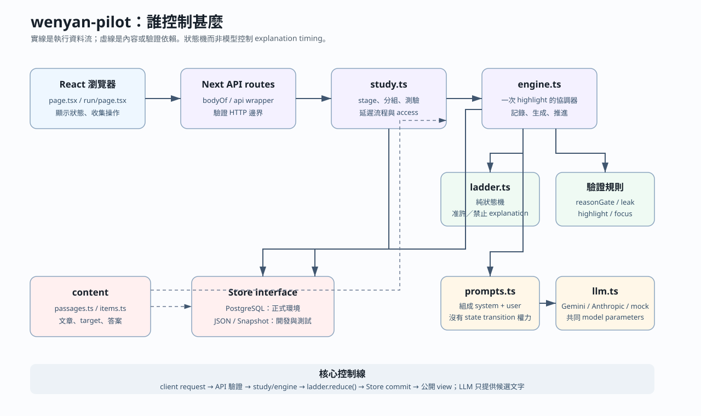
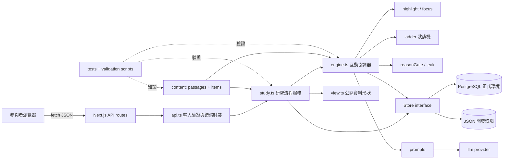
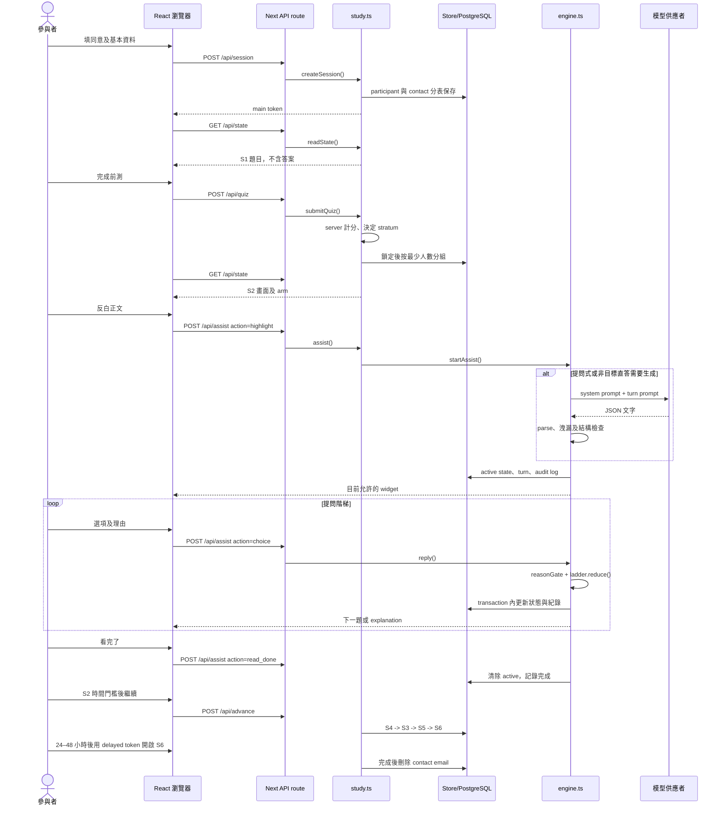
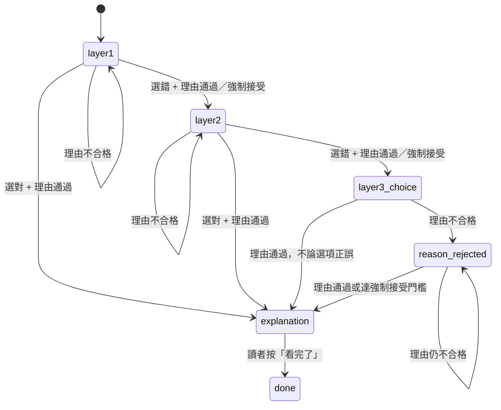
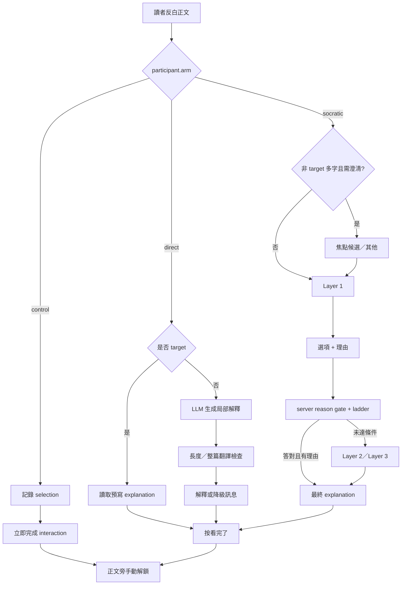

# `wenyan-pilot` 程式碼導讀

> 對象：能閱讀 C++，但未接觸 JavaScript、TypeScript、React、Next.js 或 Web 後端。
>
> 版本依據：目前工作目錄中的程式碼，`CONFIG.version = v5.7`。
>
> 本文件只解釋現況，不修改實驗流程。閱讀時若註解、README 與可執行程式互相衝突，以實際程式、測試及研究者定案為準。

## 0. 先掌握整體：這不是聊天產品

這個專案是一個三組隨機實驗工具：

| 組別 | 程式值 | 讀者反白後發生甚麼 |
|---|---|---|
| 提問式 AI | `socratic` | 系統按階梯提出觀察問題；現行版本為選項加理由；完成後才顯示解釋 |
| 直接回答式 AI | `direct` | 立即顯示解釋，不要求作答 |
| 對照組 | `control` | 只記錄反白，不顯示 AI 回應 |

它看起來像聊天介面，但本質是由伺服器控制的研究流程。大型語言模型（Large Language Model, LLM）只能產生目前步驟需要的文字，不能自行決定：

- 參與者屬於哪一組；
- 現在處於哪個階段；
- 解釋能否出現；
- 哪些資料寫入資料庫；
- 測驗答案是否正確；
- 是否排除參與者。

最重要的閱讀觀念：

```text
React 畫面不是研究規則
API route 不是核心邏輯
LLM prompt 不是狀態機

研究規則主要位於 src/lib/
畫面只是顯示伺服器准許的狀態
```

## 1. 從 C++ 轉換到 TypeScript／React 的最小知識

### 1.1 TypeScript 型別近似 C++ 的資料結構

```ts
interface Participant {
  id: string;
  arm: 'socratic' | 'direct' | 'control';
  stage: Stage;
}
```

可先想成：

```cpp
enum class Arm { Socratic, Direct, Control };

struct Participant {
    std::string id;
    Arm arm;   
    Stage stage;
};
```

差異：TypeScript 的 `interface` 只在編譯時檢查，執行時不存在。瀏覽器或惡意使用者仍可送入任何 JSON，因此伺服器還需要 `insist(...)`、`string(...)` 等執行時檢查。

### 1.2 常見語法對照

| TypeScript／JavaScript | C++ 類比 | 此專案中的意義 |
|---|---|---|
| `const x = ...` | 不允許重新指定的區域變數 | 物件內容不一定不可變，只是變數不能指向另一個值 |
| `let x = ...` | 一般區域變數 | 可以重新指定 |
| `type Arm = 'a' \| 'b'` | `enum class` 的封閉選項 | 只允許列出的字串 |
| `x?: string` | `std::optional<std::string>` | 欄位可能不存在 |
| `x ?? fallback` | `optional.value_or(...)` | `null` 或 `undefined` 時使用後備值 |
| `a?.b` | 先檢查指標／optional 再存取 | `a` 不存在時得到 `undefined` |
| `{ ...old, x: 1 }` | 複製 struct 後覆寫欄位 | React 狀態及資料更新常用 |
| `array.map(f)` | `std::transform` | 將每個元素轉成新陣列 |
| `array.filter(f)` | `std::copy_if` | 保留符合條件者 |
| `async function` | 回傳 future 的非同步函式 | 可能等待網路、模型或資料庫 |
| `await p` | 等待 future 結果 | 暫停目前函式，不阻塞整個伺服器程序 |
| `throw new Error()` | 丟出 exception | 由外層轉成 HTTP 錯誤 |
| `import`／`export` | `#include` 加命名空間的近似物 | 模組依賴；但不是文字展開 |

### 1.3 React component 是「狀態到畫面」的函式

```tsx
function Quiz({ view, token }: Props) {
  const [answers, setAnswers] = useState({});
  return <button onClick={submit}>交卷</button>;
}
```

可把 component 暫時理解為：

```cpp
UiTree Quiz(const Props& props, FrameworkManagedState& state);
```

- JSX，例如 `<button>交卷</button>`，是建立畫面樹的語法，不是 HTML 字串拼接。
- `useState` 是由 React 保存的狀態；呼叫 `setAnswers` 後，React 再呼叫 component 產生新畫面。
- `useEffect` 是畫面建立、依賴改變或卸載時執行的副作用。可類比生命週期 callback，但不是 C++ destructor。
- `useRef` 保存一個不會因重新繪製而消失、且改變時不觸發重畫的值。

### 1.4 Client、server 與 HTTP 邊界

`src/app/page.tsx` 與 `src/app/run/page.tsx` 開頭的：

```ts
'use client';
```

表示它們在瀏覽器執行。瀏覽器透過：

```ts
fetch('/api/assist', {
  method: 'POST',
  body: JSON.stringify(payload),
});
```

把 JSON 送到伺服器。`src/app/api/assist/route.ts` 的 `POST()` 是後端 request handler，近似：

```cpp
HttpResponse postAssist(const HttpRequest& request);
```

重要差異：client 的資料不可信。畫面就算已禁止某個動作，伺服器仍要重新驗證。

### 1.5 Next.js 的檔案路由

Next.js 根據路徑決定網址：

| 檔案 | 瀏覽器看到的網址／用途 |
|---|---|
| `src/app/page.tsx` | `/`，同意及基本資料頁 |
| `src/app/run/page.tsx` | `/run?t=...`，正式研究流程 |
| `src/app/api/session/route.ts` | `POST /api/session` |
| `src/app/api/state/route.ts` | `GET /api/state` |
| `src/app/api/assist/route.ts` | `POST /api/assist` |

沒有傳統 `main()`。每次 HTTP request 都從對應 route 的 `GET()` 或 `POST()` 進入。

## 2. 系統架構圖





分層責任：

1. `src/app/*.tsx`：顯示畫面、收集操作、送 HTTP request。
2. `src/app/api/*/route.ts`：把 HTTP request 接到核心函式；自身應保持很薄。
3. `src/lib/study.ts`：階段、分組、測驗、延遲測驗與研究規則。
4. `src/lib/engine.ts`：一次反白互動的協調器。
5. `src/lib/ladder.ts` 等純函式：最重要、最容易單獨測試的規則。
6. `src/lib/store*.ts`：資料保存方式。
7. `src/content/*`：文章、目標句、測驗題與答案。

## 3. 完整參與者流程

### 3.1 階段順序

實際常數位於 `src/lib/engine.ts`：

```ts
export const STAGE_ORDER = ['S0', 'S1', 'S2', 'S4', 'S3', 'S5', 'S6', 'DONE'];
```

新 session 建立後直接進入 `S1`。`S0` 是型別及順序中保留的起點，現行同意頁發生在 session 建立之前。

| 階段 | 功能 | 文章 | AI |
|---|---|---|---|
| 同意頁 | 同意、人口資料、電郵 | 無 | 無 |
| S1 | 前測及能力分層 | 短文（一） | 無 |
| S2 | 學習／閱讀操弄 | 短文（二） | 依三組不同 |
| S4 | 認知負荷問卷 | 回想 S2 | 無 |
| S3 | 同篇立即理解測驗 | 短文（二） | 無 |
| S5 | 新篇遷移測驗 | 短文（三） | 無 |
| WAIT_DELAYED | 顯示延遲測驗連結及開放時間 | 無 | 無 |
| S6 | 24–48 小時延遲測驗 | 短文（四） | 無 |
| DONE | 完成 | 無 | 無 |

S4 故意排在 S3 前面。程式註解的理由是：認知負荷要立即針對 S2 評分，若先做 S3，回憶會混入測驗本身的負荷。

### 3.2 完整時序圖



## 4. 主使用案例：提問組反白一個非目標片語

假設參與者在 S2 反白一段不是四個預寫目標句的文字。這是最長的路徑，讀懂它後，其他路徑只是刪減。

### 步驟 1：瀏覽器取得反白文字及位置

入口：`src/app/run/page.tsx` 的 `PassageText.onMouseUp()`。

輸入：瀏覽器 selection。

處理：

1. `window.getSelection()` 取得文字。
2. 若正文仍是單一 text node，計算 UTF-16 character offset。
3. 以 `passage.text.slice(...)` 再驗證 offset。
4. 呼叫 `post({ action: 'highlight', selection, start })`。

輸出：`POST /api/assist` 的 JSON。

為何同時傳文字和 offset：文章可能多次出現「之」。只靠 `indexOf('之')` 會把後面的「之」錯配到第一次出現的位置。offset 是定位提示，但伺服器仍會驗證，不盲目信任 client。

### 步驟 2：API route 開 transaction

入口：`src/app/api/assist/route.ts` 的 `POST()`。

```ts
return getStore().transaction(async store => {
  const result = await assist(store, body);
  ...
});
```

route 的責任只有：

- 用 `bodyOf()` 解析及限制 request；
- 取得 Store；
- 開 transaction；
- 呼叫 `study.ts`；
- 將內部錯誤轉成安全的 HTTP response。

它不應自己實作提問階梯。

### 步驟 3：研究服務驗證請求

入口：`src/lib/study.ts` 的 `assist()`。

檢查：

- token 必須存在；
- 必須是主流程而非 delayed token；
- participant 必須處於 S2；
- S2 尚未 timeout；
- 不能已有另一個 open interaction；
- selection 必須真的出現在正文；
- 回答舊畫面時，`interactionId` 與 `turnIndex` 必須一致。

最後一項是 stale-request protection。重新整理、雙擊或另一個舊分頁不能把舊答案提交到新階梯。

### 步驟 4：Engine 建立 ActiveInteraction

入口：`src/lib/engine.ts` 的 `startAssist()`。

它會：

1. 再次檢查 selection 屬於正文。
2. 驗證 offset；無效時退回 substring 搜尋。
3. `classifyGranularity()` 只產生分析標籤，不改寫反白文字。
4. `matchTarget()` 判斷是否碰到預寫目標句。
5. 建立 `ActiveInteraction`，包括 interaction id、原始 selection、range、granularity、初始 ladder state。

研究理由：參與者選甚麼就儲存甚麼。舊版把短反白擴成整句會改變參與者的原始行為，現行版本已取消。

### 步驟 5：多字自由反白先確認焦點

條件：

- 不是 target；
- 超過一個可見中文字；
- 不是已知註解詞。

Engine 呼叫：

- `focusOptionsSystemPrompt()`；
- `focusOptionsPrompt()`；
- `llm.complete()`；
- `validateFocusOptions()`。

模型只可以提出原反白內的 2–4 個子字串。專名後排，讀者仍可選「其他」並手動輸入原反白內字詞。

為何需要：反白「以鐵如意擊之」不代表模型知道讀者想問「以」、「如意」還是「之」。焦點選擇把解讀權交回參與者。

失敗處理：生成最多兩次，仍失敗便使用 `fallbackFocusOptions()` 的確定性候選。

### 步驟 6：產生第一層自由反白 MCQ

入口：`Engine.socraticStep()` → `Engine.socraticChoice()`。

傳給模型的內容包括：

- 完整原文；
- 有效 selection 或 focus selection；
- selection offset；
- 前一句、所在句、後一句；
- 當前 layer；
- 粒度；
- 必須產生三個 observation options 及 `answerIndex`。

模型回傳後，伺服器依序檢查：

1. JSON 能否解析；
2. question stem 是否洩漏意思、使用禁用術語、變成是非誘導或低價值照抄題；
3. 每個 option 是否洩漏；
4. options 是否剛好三個、非空、不重複；
5. `answerIndex` 是否為 0–2。

第一次失敗會把 flags 放進 retry prompt。第二次仍失敗則使用固定 fallback MCQ，並把 `answerIndex` 設為 `null`。後者代表任何選項都不能提早解鎖，避免把沒有可信答案的題當成答對。

所有生成結果、原始回覆、選項、模型宣稱的答案索引、延遲、flags 及 degraded 狀態都寫入 audit log。

### 步驟 7：參與者提交「選項＋理由」

前端 `Reading` component 根據 server 回傳的 `turn.kind` 顯示不同 widget：

| `kind` | 畫面 |
|---|---|
| `focus` | 焦點單選及「其他」 |
| `question` | 舊資料／防禦路徑的自由文字框 |
| `choice`／`reject` | 三個選項及理由欄 |
| `explanation` | 「看完了」按鈕 |
| `none` | 沒有互動 widget |

現行正常流程在 layer 1／2 使用 `choice`，不是 `question`。

提交格式：

```json
{
  "action": "choice",
  "index": 1,
  "reason": "因為前後兩處的動作對象相同",
  "interactionId": "...",
  "turnIndex": 3
}
```

### 步驟 8：理由門檻

入口：`Engine.judgeReason()` → `ruleCheckReason()`。

先使用確定性規則：

- 空白或太短：reject；
- 「不知道／猜的／隨便」且沒有其他內容：reject；
- 只重複選項：reject；
- 引用句中文字或使用因果連接詞：accept；
- 無法判斷：才交給 LLM 的 `reasonJudgePrompt()`。

LLM 只判斷「是否提出理由」，不判斷推論正確。錯誤但有解釋的理由應接受。

如果模型 timeout、格式錯誤或回傳未知 verdict，目前採 fail-open：接受該理由，同時在 event log 記錄 `failOpen: true`。這避免模型失效把參與者鎖死，但研究者必須事後稽核。

目前 `CONFIG.maxReasonRejections = 2`，而 `shouldForceAccept(rejections)` 使用 `>= 2`。因此實際行為是第二次不合格即強制接受並標記 `reasonInsufficient`。部分註解仍寫「第三次」；這是已知規格衝突，不能只信註解。

### 步驟 9：狀態機決定下一步

入口：`src/lib/ladder.ts` 的純函式 `reduce(state, event)`。



真正控制解釋的函式只有：

```ts
explanationAllowed(state)
```

LLM 回傳甚麼文字都不能把 `state.step` 直接改成 `explanation`。

### 步驟 10：顯示最終解釋

入口：`Engine.explanationFor()`。

- target selection：直接取 `TargetSentence.explanation`，提問組與直答組逐字相同。
- free selection：用 `directSystemPrompt()` 生成局部解釋，再用 `checkDirectOutput()` 檢查長度及是否變成整篇翻譯；失敗重試一次，再失敗顯示系統降級訊息。

即使提問組在 layer 1 已答對，仍會顯示相同 target explanation。原因不是教學必要，而是實驗比較需要內容暴露一致，否則能力較高者會同時看得較少。

### 步驟 11：完成及解鎖

參與者按「看完了」後：

1. client 送 `action: 'read_done'`；
2. server 確認目前確實為 `explanation`；
3. `completeInteraction()` 記錄結束位置、拒絕次數、總時間；
4. target id 去重後加入 `completedTargets`；
5. `participant.active = null`；
6. client 仍把正文保持 locked/finished；
7. 參與者按反白旁的「解鎖，換下一句」才可再選。

最後一步只解除 client 顯示鎖；真正防止同時開兩段互動的是 server 在新 highlight 前檢查 `!p.active`。

## 5. 三組流程比較



### 共用部分

- 同一篇 S2 文章；
- 相同正文欄寬；
- 沒有 target 底色；
- 沒有強制使用次數；
- 相同最少閱讀時間 180 秒；
- 相同模型設定來源 `CONFIG.llm`；
- target 的最終解釋逐字相同；
- 都記錄反白；
- 都要手動解鎖才可換下一處。

### 不同部分

| 面向 | Socratic | Direct | Control |
|---|---|---|---|
| 側欄 | 有 | 有 | 無 |
| 模型輸出 | 問題／選項；free selection 最後也可能生成解釋 | 非 target 生成解釋 | 無 |
| 讀者輸入 | 焦點、選項、理由 | 只按看完了 | 無 AI 回應 |
| interaction 時間 | 較長且回合較多 | 較短 | 最短 |
| 是否經 ladder | 是 | 否 | 否 |

[Inference] 雖然模型參數共用，三組接受的互動劑量、等待時間及輸入 effort 並不相同。因此不能把研究操弄描述為「只有 system prompt 不同」。

## 6. Prompt 資料流

### 6.1 Prompt 不是直接從前端送出

```text
前端 selection
  -> study.assist()
  -> Engine 決定目前需要哪種生成
  -> prompts.ts 組成 system + user prompt
  -> llm.ts 使用共同 model parameters
  -> provider 回傳文字
  -> parseJsonObject()
  -> leak／structure validation
  -> Engine 才決定可否送給 participant
```

### 6.2 七類 prompt

| Prompt | 用途 | 主要限制 |
|---|---|---|
| `focusOptionsSystemPrompt` | 長反白中的焦點候選 | 只能複製反白中的字詞，不解釋 |
| `socraticSystemPrompt` | 提問式 AI 身份及禁令 | 不翻譯、不說答案、不用禁用術語、不自行放行 |
| `socraticTurnPrompt` | 注入本次文章、selection、offset、鄰句、layer | layer 1/2 只問可見觀察線索 |
| `directSystemPrompt` | 直接解釋組身份 | 只解釋選取範圍，不問問題 |
| `directTurnPrompt` | 注入 selection 與 granularity | retry 時指出上一輪違規 |
| `reasonJudgePrompt` | 模糊理由的二分類 | 只判有無理由，不判理由正誤 |
| `answerJudgePrompt` | 舊自由文字答案路徑 | 判斷是否等同 target reference answer |

### 6.3 相同與不相同

兩個 AI 組共同使用：

- `CONFIG.llm.model`；
- `temperature`；
- `maxTokens`；
- timeout；
- retry 次數；
- 每回合字數上限；
- 同一 provider class。

不同：

- system prompt；
- user prompt；
- 呼叫次數；
- 提問組另有 focus、reason judgement、MCQ generation；
- target explanation 不經模型生成；
- free selection 的解釋可能經模型生成。

### 6.4 防 prompt 失效的四層

1. Prompt instruction：告訴模型不能做甚麼。
2. Parser：只接受指定 JSON 形狀。
3. Deterministic validator：檢查禁句、術語、是非題、長度、options 結構。
4. State machine：即使模型違規，也無權決定解釋何時出現。

只有第 4 層能從結構上保證 disclosure timing。Prompt 本身不能提供這項保證。

## 7. 為何這樣設計：十個關鍵 invariant

### 7.1 模型不能控制 explanation timing

位置：`ladder.ts`、`engine.ts`。

如果只在 prompt 寫「不要太早給答案」，模型仍可能違規。把權力留在 `reduce()` 後，模型輸出不包含任何 state-transition command。

### 7.2 兩個 AI 組的 target explanation 完全相同

位置：`TargetSentence.explanation`、`Engine.explanationFor()`。

若提問組與直答組最後看到不同內容，學習結果可能來自內容差異，而不是「先問還是先講」。

### 7.3 選對但沒有理由不能提早解鎖

位置：`ladder.reduce()`。

三選一有猜中機率。理由門檻防止只靠 lucky pick 跳過整個提問操弄。

### 7.4 前端拿不到測驗答案

位置：`view.ts` 的 `publicItem()`。

`Item.answerIndex` 只在 server 計分；送給 client 的物件只有 `id`、`stem`、`options`、`level`。

### 7.5 Highlight 完全自由

位置：`engine.startAssist()`、`highlight.classifyGranularity()`。

粒度只作分析標籤，不改寫 selection。模型如果需要上下文，系統另外提供 neighborhood，而不是暗中改變反白。

### 7.6 使用 AI 完全自願

位置：`CONFIG.lowerBoundArms = []`。

不使用本身是 pilot finding；不能因 participant 沒使用而移除資料。`no_assist_used` 是 descriptive flag，不是 exclusion。

代價：三組使用量不再 matched，分析必須報告使用量，不能把 outcome 全部歸因於回答形式。

### 7.7 所有人都有相同 S2 最少停留時間

位置：`CONFIG.minReadingSeconds = 180`、`study.advanceStage()`。

AI 使用量不強制後，至少保留相同最低閱讀時間。

### 7.8 Timeout 只標記，不刪除

位置：`study.submitQuiz()`、`advanceStage()`。

這符合 intention-to-treat（ITT，依原分組分析）：參與者仍保留，只增加 flag。

### 7.9 Client 永遠不是 authority

伺服器自己計算 elapsed time、答案 correctness、目前 stage、active interaction、turn index。client 傳來的 `elapsedSeconds` 不被用作正式判斷。

### 7.10 正式收案與 dry run 分開

位置：`study.createSession()`。

`STUDY_MODE=collection` 時必須同時符合：

- `validateContent()` 沒有錯誤；
- provider 是 Gemini 或 Anthropic；
- pinned model id 存在；
- API key 存在。

因此 `draft: true` 不是一般 warning，而是阻止正式收案的 gate。

## 8. 資料保存：從記憶體物件到 PostgreSQL

### 8.1 Store 是抽象介面

`src/lib/store.ts` 的 `Store` 近似 C++ abstract base class：

```cpp
class Store {
public:
    virtual Participant getParticipant(Id) = 0;
    virtual void addInteraction(InteractionRow) = 0;
    virtual ~Store() = default;
};
```

實作：

- `JsonStore`：本機單程序 dry run；寫入 `data/db.json`。
- `SnapshotStore`：測試及 transaction-local snapshot。
- `PostgresStore`：正式環境。

`getStore()` 的規則：有 `DATABASE_URL` 使用 PostgreSQL；production 沒有資料庫連線便直接失敗，不能默默退回 JSON。

### 8.2 主要資料表

| 表 | 內容 |
|---|---|
| `participants` | arm、stage、stratum、active interaction、flags |
| `responses` | 每題答案、正誤、反應時間 |
| `interactions` | 反白、每個 user/system turn、prompt audit 欄位 |
| `events` | stage、離開全螢幕、理由判斷等事件 |
| `scales` | 認知負荷三個 subscale |
| `participant_contacts` | email；與研究資料分表 |

正式 schema 是 `db/schema.sql` 加 `db/migrations/*`。只讀 base schema 會漏掉後續認知負荷欄位及 contact table。

### 8.3 Transaction 的必要性

一次 assist request 可能同時：

- 寫 interaction row；
- 寫 event；
- 更新 participant.active；
- 更新 turn index。

若其中一半成功、一半失敗，重新整理後就會進入無法恢復的矛盾狀態。因此 API routes 使用 `store.transaction(...)`。

前測分組另使用 `assignment_lock FOR UPDATE`。否則兩名參與者同時完成前測時，都可能讀到相同舊人數並被分到同一組。

## 9. Reload recovery 如何運作

問題：若 participant 在提問中重新整理，React 的 `useState` 全部消失。

處理：

1. `Participant.active` 保存在 server/database。
2. `ActiveInteraction.activeChoice` 保存當前生成 options 及 answer index。
3. `GET /api/state` 呼叫 `pendingTurnFor()` 重建 widget。
4. `GET /api/transcript` 重新載入整個 S2 對話。
5. client 以 `pendingRange` 重畫反白範圍。
6. server 仍檢查 `interactionId` 與 `turnIndex`。

這解釋了為何 active state 不是只放在 React component。

## 10. 現行選項版與擬議自由作答版

### 10.1 現行版本

```text
Layer 1：三個選項 + 理由
  正確 + 理由通過 -> explanation
  錯誤 + 理由通過 -> Layer 2

Layer 2：三個選項 + 理由
  正確 + 理由通過 -> explanation
  錯誤 + 理由通過 -> Layer 3

Layer 3：bottom-out 選項 + 理由
  不論正誤，理由通過 -> explanation
```

### 10.2 擬議版本

```text
Layer 1：我的判斷 + 我的理由／文本依據
  只檢查有實質嘗試，不判正誤 -> Layer 2

Layer 2：另一線索的判斷 + 理由
  只檢查有實質嘗試 -> Layer 3 bottom-out

Layer 3：經簽核提示／答案框架
  -> 相同 explanation
```

### 10.3 不能只改畫面

自由作答版至少會改到：

- `types.ts`：turn payload、active state、audit fields；
- `run/page.tsx`：composer；
- `study.assist()`：允許的 action；
- `engine.reply()`：移除 layer 1/2 option scoring；
- `ladder.ts`：固定回合或 attempt gate；
- `prompts.ts`：不再要求 options／answerIndex；
- `leak.ts`：移除 option structure validation，但保留 question leakage；
- `tests/engine.test.ts`、`tests/unit.test.ts`、`tests/study.test.ts`；
- content target layer 1/2 題目及人工簽核；
- analysis plan。

核心原則不應改變：LLM 不得判斷能否解鎖。若不判答案正誤，就由 deterministic attempt gate 決定兩欄是否有實質內容，完成固定輪數後進入 bottom-out。

## 11. 讀程式的建議順序

### 第一階段：建立名詞地圖

難度：低。目標：知道資料有哪些，不追流程。

必讀：

1. `src/lib/types.ts`
2. `src/lib/config.ts`
3. `src/content/passages.ts` 只讀 `Passage` 與一個 target
4. `src/content/items.ts` 只讀一題及檔尾分組

可略讀：40 題完整內容、所有文章全文。

理解檢查：

- `Participant.active` 為何不能只存在 client？
- `InteractionRow` 與 `EventRow` 有何不同？
- `draft: true` 為何不是「內容空白」？

### 第二階段：先讀純規則

難度：中。目標：不看 UI 也能手動推演階梯。

必讀：

1. `src/lib/ladder.ts`
2. `src/lib/reasonGate.ts`
3. `src/lib/highlight.ts`
4. `src/lib/leak.ts`
5. 對照 `tests/unit.test.ts`

理解檢查：

- layer 1 選對但理由被拒後 state 是甚麼？
- degraded free MCQ 為何不能提早結束？
- `matchTarget()` 為何需要 offset？

### 第三階段：追一次 highlight

難度：高。目標：看懂 client → server → state machine → database。

依序設 breakpoint 或搜尋：

1. `run/page.tsx: PassageText.onMouseUp`
2. `run/page.tsx: Reading.post`
3. `api/assist/route.ts: POST`
4. `study.ts: assist`
5. `engine.ts: startAssist`
6. `engine.ts: socraticStep`
7. `engine.ts: reply`
8. `ladder.ts: reduce`
9. `engine.ts: explanationFor`
10. `engine.ts: completeInteraction`

理解檢查：

- 哪一層阻止第二個 highlight？
- 哪個函式真正決定 explanation 是否允許？
- reload 後 options 從哪裡恢復？

### 第四階段：讀 prompt，但不要先讀 prompt

難度：中。目標：分清生成文字與研究規則。

必讀：

1. `src/lib/prompts.ts`
2. `src/lib/llm.ts`
3. `engine.ts: socraticChoice`
4. `engine.ts: explanationFor`
5. `tests/llm.test.ts`
6. `tests/audit.test.ts`

先讀狀態機再讀 prompt，否則容易錯以為 prompt 控制整個研究。

### 第五階段：讀完整研究流程

難度：高。目標：理解分組、測驗、時間及延遲流程。

必讀：

1. `src/lib/study.ts`
2. `src/lib/randomize.ts`
3. `src/lib/view.ts`
4. `src/lib/scoring.ts`
5. `tests/study.test.ts`

理解檢查：

- arm 何時才真正分派？
- 為何 S1 response 後要用 assignment transaction lock？
- delayed token 與 main token 有何不同？
- 為何 S3 participant 仍可看到文章但看不到 annotations？

### 第六階段：讀儲存與部署

難度：高。目標：知道資料在 production 如何保持一致。

必讀：

1. `src/lib/store.ts`
2. `src/lib/store.postgres.ts`
3. `db/schema.sql`
4. `db/migrations/*`
5. `src/app/api/admin/export/route.ts`

可略讀：欄位名稱轉換 helper 的逐行實作。

理解檢查：

- production 為何不能使用 JSON store？
- email 為何不在 participant row？
- transaction rollback 防止哪類研究資料矛盾？

## 12. 使用除錯器或 log 的實際讀法

### 12.1 不修改程式的閱讀命令

```powershell
rg -n "startAssist|socraticStep|reply|explanationFor" src/lib/engine.ts
rg -n "fetch\('/api/assist|action: 'choice'|action: 'read_done'" src/app/run/page.tsx
rg -n "explanationAllowed|case 'layer" src/lib/ladder.ts
npm run prompts:inspect -- 帝甚不平
```

最後一個命令只列出 prompt，不應呼叫真正模型。

### 12.2 讀測試時使用 Arrange–Act–Assert

測試通常可拆成：

```text
Arrange：建立 participant、fake store、mock LLM
Act：startAssist 或 reply
Assert：下一個 turn、ladder state、interaction log
```

測試名稱本身就是規格。先讀：

- `engine.test.ts > does not open the explanation on a lucky pick with no reason`
- `engine.test.ts > never ends the ladder early on a fallback rung`
- `engine.test.ts > reload recovery`
- `audit.test.ts > identical full explanation`
- `study.test.ts > rejects early completion, invalid options, stale turns and open-text bypass`

### 12.3 建議親自推演的三個案例

案例 A：target，layer 1 選對但理由空白。

預期：停留 layer 1、顯示理由退回，不顯示 explanation。

案例 B：free highlight，模型連續兩次輸出洩答 options。

預期：固定 fallback MCQ、`degraded=true`、`answerIndex=null`，任何 pick 都不能 layer 1 提早完成。

案例 C：提問中重新整理。

預期：`GET /api/state` 恢復 `pendingTurn`、range、同一組 options；transcript 重新載入。

## 13. 已確認的程式現況與閱讀陷阱

### 13.1 舊註解與現行行為不一致

`src/lib/types.ts` 的 `TargetSentence.layer1Choice` 註解，以及 `src/lib/ladder.ts` 頂部說明，仍提到 free highlights 在 layer 1/2 使用 open text。

但現行可執行路徑及測試是：

- `Engine.socraticStep()` 對 free highlight 呼叫 `socraticChoice()`；
- `run/page.tsx` 顯示 options + reason；
- `engine.test.ts` 驗證 generated MCQ；
- `study.test.ts` 阻止 open-text bypass。

因此閱讀這兩處註解時必須標記為歷史描述，不應用它推斷現行 UI。

### 13.2 Free-highlight layer 3 尚未 grounded

`choiceForSelection()` 對非 target 使用固定三選項及固定 `answerIndex: 0`，程式註解已明確稱為 unresolved research limitation。不能把它當作已驗證的語義答案。

### 13.3 理由強制接受次數有規格衝突

註解稱「第三次」，現行實作在第二次 rejection 便強制接受。教授定案後必須同步 config、註解、程式及測試。

### 13.4 前端註解有少量歷史語句

例如 `view.ts` 某些註解仍說 AI arms 看到 shaded targets，但 `CONFIG.targetHintArms` 現為空陣列，實際上三組都不顯示底色。判斷時要追到 config 與測試。

## 14. 驗證結果

本次導讀建立前實際執行：

| 指令 | 結果 |
|---|---|
| `npm test` | 通過：8 個 test files、118 tests |
| `npm run typecheck` | 通過 |
| `npm run smoke` | 未進入測試：本機 `tsx` 啟動時發生 `uv_os_get_passwd returned ENOMEM` |
| `npm run validate:content` | 未進入檢查：同一 `tsx`／`ENOMEM` 環境錯誤 |
| `node scripts/verify-offline.mjs` | 通過；包含 118 tests、三組 smoke；內容 gate 正確回報 48 errors |

48 個內容錯誤是：40 題尚待 reviewer sign-off、4 篇文章未完成指定版本核校、4 個 target ladders 仍為 draft。這是正式收案 gate，不是應由程式員翻旗標消除的測試失敗。

## 15. 一句話記憶每個核心檔案

| 檔案 | 一句話 |
|---|---|
| `types.ts` | 系統內所有研究名詞的資料形狀 |
| `config.ts` | 會改變實驗的數字與開關 |
| `study.ts` | 整個 participant lifecycle |
| `engine.ts` | 一次反白互動的總指揮 |
| `ladder.ts` | 解釋何時准許出現 |
| `reasonGate.ts` | 是否真的提供了理由 |
| `highlight.ts` | selection 類型、位置、target matching |
| `focus.ts` | 長反白究竟想問哪個字詞 |
| `prompts.ts` | 模型每種任務收到的 instruction |
| `leak.ts` | 模型文字送給 participant 前的機械檢查 |
| `llm.ts` | Gemini、Anthropic、mock 的共同介面 |
| `view.ts` | server 允許 client 看見的資料 |
| `store.ts` | 儲存抽象及環境選擇 |
| `run/page.tsx` | participant 畫面與 request 發送 |
| `tests/*` | 可執行的研究規格 |

## 16. 最短閱讀路徑

若只有 60 分鐘：

1. `types.ts`：只讀 `Participant`、`ActiveInteraction`、`LadderState`。
2. `ladder.ts`：完整讀完。
3. `engine.ts`：只讀 `startAssist()`、`reply()`、`explanationFor()`。
4. `prompts.ts`：讀兩個 system prompt 與 reason judge。
5. `view.ts`：確認答案如何被移除。
6. `engine.test.ts`：讀 target 正確、有／無理由、fallback、reload 四組案例。

完成後應能回答：

> 一名提問組 participant 反白「之」後，哪個函式定位它、哪個函式出題、哪個函式判理由、哪個函式准許 explanation、哪張表保存每一回合，以及重新整理後如何恢復。
