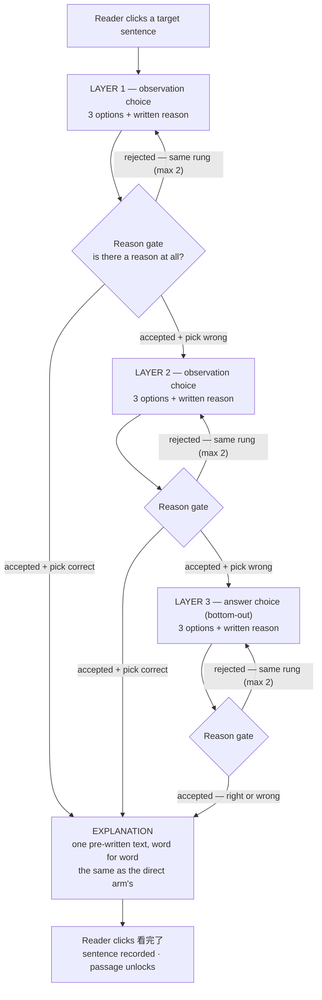

# Socratic Ladder — how the questioning arm works

Stage S2, learning passage 《世說新語·汰侈》. Reflects the ladder as implemented in
`src/lib/ladder.ts` and `src/lib/engine.ts`.

A reader in the **questioning arm** clicks one of the four target sentences. Every rung
has the same shape: a three-option multiple choice, plus a written reason. The pick is
recognition; the reason is production. The reader never faces a blank box asking what the
answer is — only why they chose it.

After two rejections on a rung the reader is forced through and flagged
`reasonInsufficient` — they can be slowed down, never trapped.

---

## Why a correct pick is not enough

A three-option choice is right **one time in three** by luck. If a correct pick alone
opened the explanation, roughly a third of readers would skip the ladder entirely — and
for them the questioning manipulation would simply not have happened. The reason gate is
the only thing standing between the study and that hole.

The gate judges whether a reason **exists**, not whether it is right. A wrong but reasoned
answer passes. 「不知道」, 「猜的」 and bare echoes of an option do not. Unclear cases go
to the model.

---

## A worked sentence

Target 「以鐵如意擊之，應手而碎」 — language point: 「之」 as a pronoun.

| Rung | Question | Options (key in bold) |
|---|---|---|
| 1 | 先看這一句裡的「之」。它前面緊接著的「擊」，是一個動作還是一個東西？ | **一個動作（敲、打）** / 一個東西（器物） / 一個形容的詞 |
| 2 | 「擊」是一個動作。那麼「被敲的東西」在這句話裡出現在哪裡？ | 在「擊」的前面 / **在「擊」的後面** / 這句話裡沒有寫出來 |
| 3 | 「擊之」的「之」在這句話裡的作用比較像哪一個？ | 的 / **指某個東西** / 往、去 |
| — | Explanation | 「之」是代詞，指珊瑚樹，接在動作「擊」後面，是被敲的對象。 |

Rungs 1 and 2 ask about **observations** — what part of speech sits beside the word, where
the struck object appears. Neither can give the layer-3 answer away, and
`npm run validate:content` fails the build if a rung's options duplicate the layer-3 ones.

All four target sentences are still `draft: true`: written, not signed off.

---

## What separates the three arms

The ladder is the whole manipulation. Strip it out and you have the direct arm; strip out
the response as well and you have the control arm.

| | Shaded sentences | Conversation sidebar | Gate to continue | After a highlight |
|---|---|---|---|---|
| **Questioning** | yes, four | yes | all four asked once | 3 rungs → explanation |
| **Direct** | yes, four | yes | all four asked once | explanation immediately |
| **Control** | none (server does not send the list) | none | 180 seconds on the passage | recorded, nothing shown |

The explanation string is identical in both AI arms. That parity is what makes the
questioning-versus-direct comparison mean anything.

---

## Invariants worth defending at the viva

1. **The model never decides when the explanation appears.** A server-side state machine
   does (`src/lib/ladder.ts`). The model only writes the text for the rung the machine is
   already on, so "the explanation came too early" is impossible by construction rather
   than by prompt discipline.
2. **A correct pick alone never opens the explanation.** The reason must pass too.
3. **Both AI arms receive the identical explanation** — the same stored string, not a
   paraphrase and not a regeneration.
4. **Rungs 1 and 2 ask about observations, never meaning.** Enforced by the content validator.
5. **Where the reader stopped is the record**, not just whether they were right:
   `endPosition` ∈ {`layer1_correct`, `layer2_correct`, `choice_correct`, `choice_wrong`}.
6. **Nobody can be trapped.** Two rejections per rung, then forced through and flagged.
   A stuck reader is a dropout, and a pilot of fifteen per arm cannot afford one.

---

An HTML version of this figure (for slides — open it and screenshot the diagram) lives at
`docs/socratic-ladder.html` in the repo, and is published as a Claude artifact.
